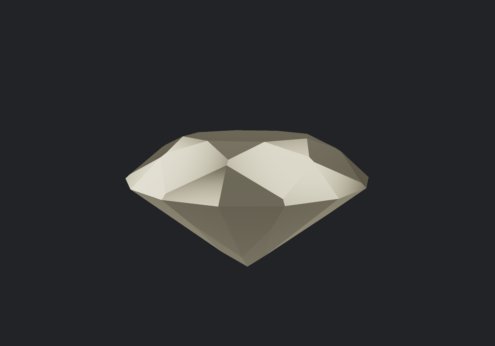

# Carat

A physically-based **spectral ray tracer for gemstones**, written from scratch
against raw WebGPU. One HTML file, no dependencies, no build step.



## What this is

Most renderers carry light as three numbers — red, green, blue. This one carries
a **wavelength**, sampled from 400–700 nm, and recomputes the stone's refractive
index from that wavelength at every surface it touches. Dispersion is not painted
on afterwards; it falls out of the maths. That is what *fire* actually is.

The stone is not a mesh. It is the **intersection of 65 half-spaces** — a table,
8 stars, 8 bezels, 16 upper-girdle facets, a girdle band, 16 lower-girdle facets
and 8 pavilion mains, at the real angles for a 34.5°/40.75° round brilliant. A ray
misses unless it is inside *every* half-space, so one ordered loop replaces a mesh
traversal, a BVH, and every floating-point normal you would otherwise have to
interpolate.

Buffers, bind groups, uniform layouts, the render pipeline, the WGSL, and the
readback path for PNG export are all written against the raw API. There is no
engine underneath this.

## Run it

Open `prism/web/gem.html` in Chrome or Edge (WebGPU required). Drag to orbit,
scroll to zoom. Sliders control internal resolution, wavelength count, bounce
depth, dispersion, exposure and anti-aliasing. Two presets: a prism and a
65-facet brilliant.

Everything is inline, so it runs straight off disk — no server, no build step.
To serve the whole repo instead:

```
python -m http.server 8000
```

then visit `/portfolio/` for the case study and `/directory/` for the directory.

## What's in here

| Path | |
|---|---|
| `prism/web/gem.html` | the renderer — geometry, optics, UI, PNG export |
| `prism/reference/optics.py` | independent physics reference (numpy), asserting the Fresnel and dispersion figures the shader uses |
| `prism/renders/` | exported frames |
| `portfolio/` | a case study page: what it does, what I measured, and what went wrong |
| `directory/` | a searchable listing of independent jewellers who take on custom work |
| `probe/gpu-probe.html` | WebGPU capability probe and micro-benchmarks |
| `laptop-verdict.md` | the working log — measurements, decisions, and every bug |

## What it deliberately does not claim

Two honest limits, both discussed in full on the case study page:

- **It is not photorealistic.** The environment is an analytic function, not an
  HDRI. Dispersion is computed correctly and is *still* barely visible, because a
  broad softbox reflected in a facet smears the separated wavelengths back into
  white. Fire needs small, bright sources against darkness. That is the next job,
  and `laptop-verdict.md` records the experiment that proved it.
- **Nothing reads as coloured stone.** Every material is a pure dielectric with a
  Cauchy index and no absorption, so a sapphire is not possible yet.

It also makes **no grading claims**, ever. This is a mechanism, not a grade, and
it does not say what any stone is worth.

## The bug log

`laptop-verdict.md` is the part most worth reading. Nine bugs, nearly all of which
produced a *plausible number from a broken renderer* — including a benchmark that
reported a confident 63.5 fps because an invalid pipeline was submitting nothing
at all, sixteen facets that were mathematically present and completely invisible,
and a preset that was quietly authoring a "prism" out of diamond's refractive
index.

The theme running through all of them: **validate the output, not just the speed.**
