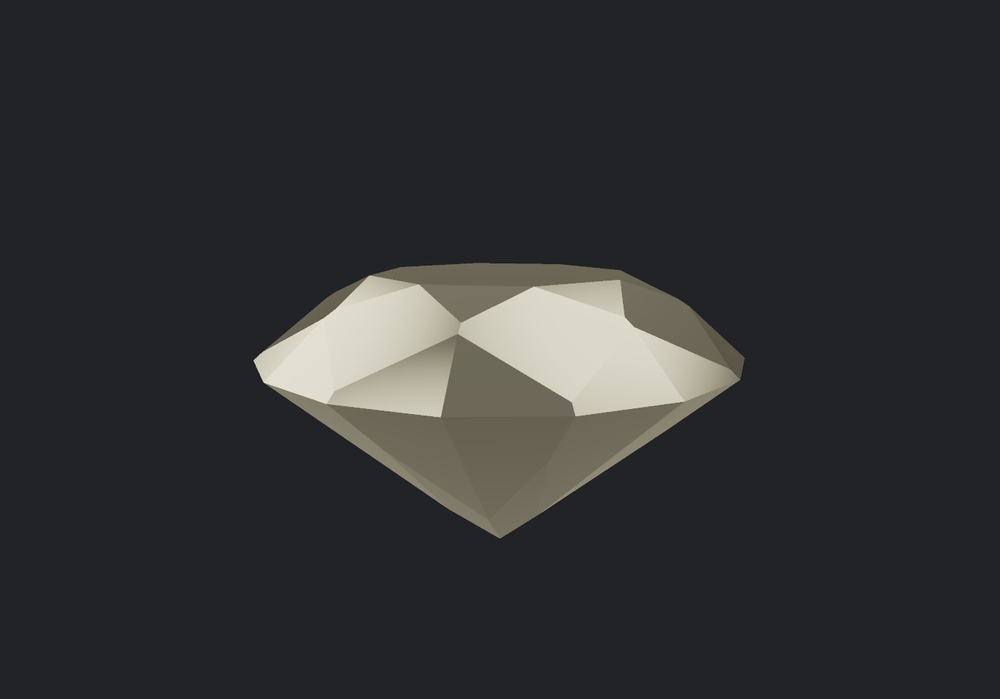

# Carat

A spectral ray tracer for gemstones, written from scratch against raw WebGPU.
One HTML file, no dependencies, no build step.



Live: [mnb4556.github.io/carat](https://mnb4556.github.io/carat/)

## How it works

Most renderers carry light as three numbers: red, green and blue. Carat carries
a wavelength sampled between 400 and 700 nm, and recomputes the stone's
refractive index from that wavelength at every surface the ray touches.
Dispersion comes out of the maths instead of being added afterwards.

The stone is the intersection of 65 half-spaces: a table, 8 stars, 8 bezels,
16 upper-girdle facets, a girdle band, 16 lower-girdle facets and 8 pavilion
mains, at the real angles for a 34.5/40.75 round brilliant. A ray only continues
if it is inside all 65, so intersection is one ordered loop over planes instead
of a mesh traversal, a BVH, and interpolated normals.

Buffers, bind groups, uniform layouts, the render pipeline, the WGSL and the
readback path for PNG export are all written against the raw API. No engine sits
underneath it.

## Running it

Open `prism/web/gem.html` in Chrome or Edge. WebGPU is required. Drag to orbit
and scroll to zoom. The sliders control internal resolution, wavelength count,
bounce depth, dispersion, exposure and anti-aliasing. There are two presets, a
prism and a 65-facet brilliant.

Everything is inline, so it runs from disk without a server. To serve the whole
repository instead:

```
python -m http.server 8000
```

Then `/portfolio/` is the case study and `/directory/` is the jeweller
directory.

## What is in the repository

| Path | |
|---|---|
| `prism/web/gem.html` | the renderer: geometry, optics, UI, PNG export |
| `prism/reference/optics.py` | a second model of the optics in numpy, used to check the Fresnel and dispersion figures the shader relies on |
| `prism/renders/` | exported frames |
| `portfolio/` | the case study page |
| `directory/` | a searchable list of independent jewellers who take custom work |
| `probe/gpu-probe.html` | WebGPU capability probe and micro-benchmarks |
| `laptop-verdict.md` | the working log: measurements, decisions and bugs |

## What it does not do

- It is not photorealistic. The environment is an analytic function rather than
  an HDRI. Dispersion is computed correctly and is still hard to see, because a
  broad softbox reflected in a facet smears the separated wavelengths back
  towards white. Small bright sources against darkness show it better, and that
  is the next piece of work.
- Nothing reads as coloured stone. Every material is a pure dielectric with a
  Cauchy index and no absorption, so a sapphire is not possible yet.
- It makes no grading claims. This is a mechanism, not an appraisal, and it says
  nothing about what a stone is worth.

## Bugs

`laptop-verdict.md` records nine bugs, most of which produced a plausible number
from a broken renderer. One benchmark reported a confident 63.5 fps while an
invalid pipeline submitted nothing at all. Sixteen facets were mathematically
present and completely invisible. One preset was quietly building a "prism" out
of diamond's refractive index.

## Licence

Source-available, not open source. You may read it, run it, learn from it and
quote it with attribution. Please do not redistribute it. See [LICENSE](LICENSE).
